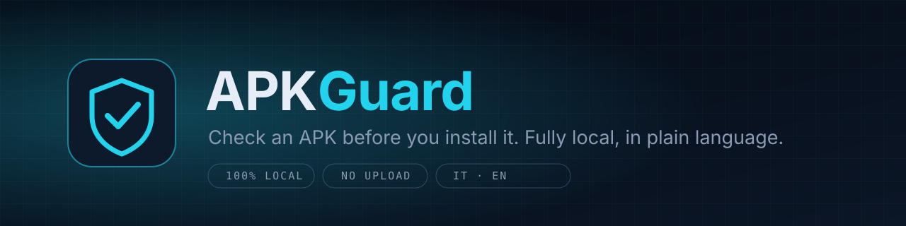
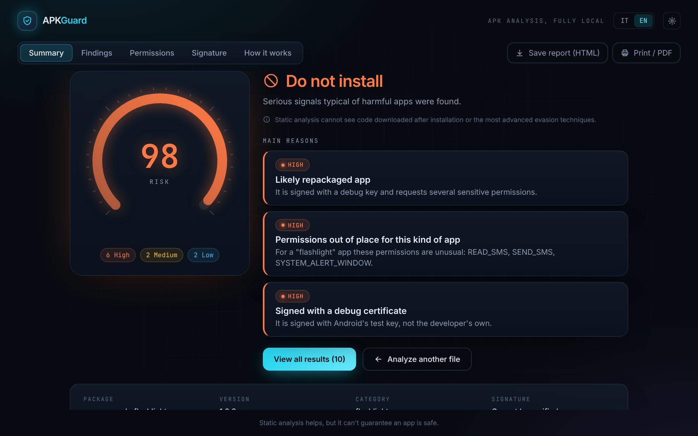
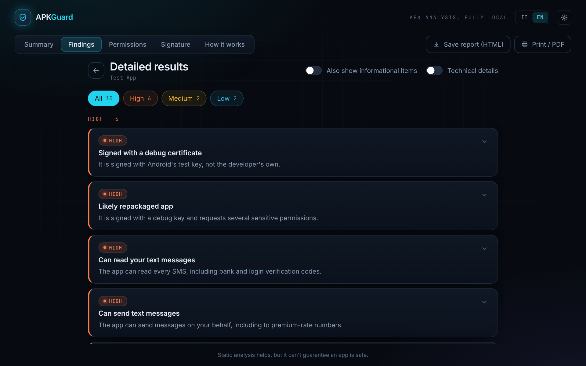
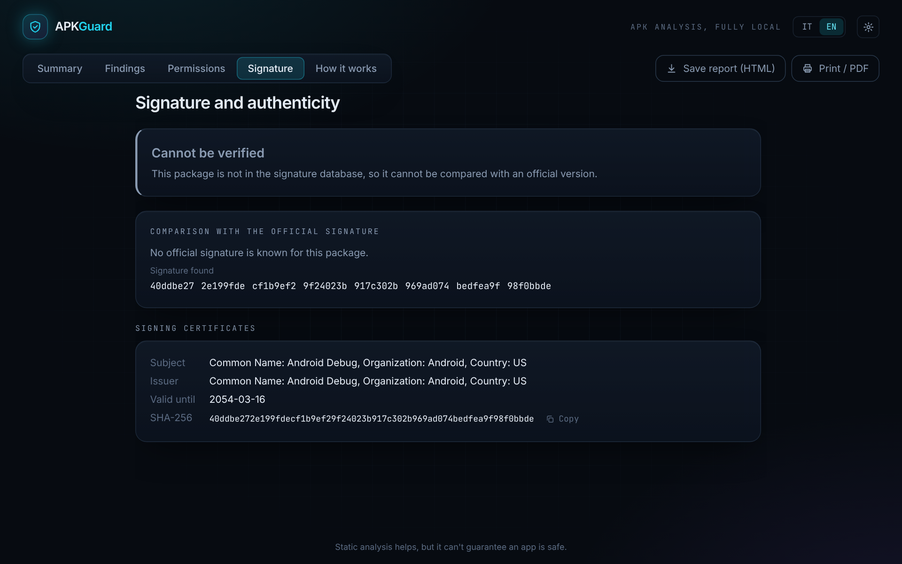

<p align="center">
  
</p>

<p align="center">
  <a href="https://github.com/VjAlbert/Doctor-APK/releases/latest"></a>
</p>

<p align="center">
  <a href="https://github.com/VjAlbert/Doctor-APK/actions/workflows/build.yml"></a>
  
  
  
</p>

**APKGuard** is a desktop app that inspects an Android APK *before* you install it and explains what it found in plain language: threats ranked by severity, what each permission really allows, who signed the app, and what the code can do. Nothing is uploaded; the analysis runs on your computer.

> Personal project, not a product for sale. A clean result is never a guarantee of safety (see [Limits](#limits)).

<p align="center">
  
</p>

## What it does

| | |
|---|---|
| **Verdict and risk score** | Three states (*no known threats*, *caution*, *do not install*) with a 0-100 gauge and the main reasons first. Many weak signals alone never produce "do not install". |
| **Findings by severity** | Sensitive APIs, dynamic code loading, packers, anti-analysis tricks, hidden payloads inside the archive, suspicious indicators (URLs, IPs, Telegram or Discord exfiltration), generic YARA behaviour rules, crypto miners. Each finding says what it means and what to do. |
| **Permissions in plain words** | Judged against the kind of app: a flashlight asking for SMS is far worse than a messenger asking for it. |
| **Signature check** | Compares the signing certificate with a database of known fingerprints (4,901 F-Droid packages). A mismatch against a developer key points to tampering; against a store key it only means the APK came from another channel. |
| **How it works** | Reads the code (cross-references and a built-in decompiler, no Java needed) and shows what the app can do, where, and what starts it (launcher, boot, incoming SMS...). Read-only. |
| **Reports** | Save as HTML or print to PDF. History of recent analyses, with a notice when a saved result came from an older engine. |
| **Italian and English** | The whole interface and every finding, switchable at any time. |

<p align="center">
  
  
</p>

*Screenshots show a harmless synthetic test app built for the demo, not a real product.*

## Optional: explanations with your own Claude

A **Connect Claude** button in Settings detects a Claude Code that *you* installed and signed in to, and uses it to explain a report or a piece of code in plain language. APKGuard never sees or stores your credentials: it only asks that program for its status and runs it with every tool disabled, in an empty throw-away directory, one request at a time. Only an analysis summary is sent (never the file), and the interface can show you the exact text first. Code and strings from the analysed app are treated as untrusted data in every prompt. Without it, everything else works.

## Install

1. Download the installer from **[Releases](https://github.com/VjAlbert/Doctor-APK/releases/latest)** (or an artifact from the latest successful run under **Actions**).
2. Check the download against the published SHA-256 (`Get-FileHash .\APKGuard-setup.exe`).
3. Run it. The installer is **not code-signed yet**, so Chrome and Windows SmartScreen may warn: *Keep*, then *More info, Run anyway*.

Upgrading: close APKGuard first. In **Settings, About** the interface and the engine must show the same build.

## Limits

- **Static analysis only.** It cannot see code downloaded after installation or advanced evasion.
- **Provisional calibration.** Weights and thresholds were tuned on synthetic apps and a handful of real ones. Advertising libraries in ordinary apps and games still raise "caution" more often than they should. Treat the score as a guide, not a measurement.
- **Signature database.** It covers F-Droid apps. Commercial apps (for example from Google Play) show "cannot be verified".
- **VirusTotal lookup** (optional, your own key) has only been tested against simulated responses.
- Windows only for now; the Linux build is paused.

## Architecture

```
app/        Tauri 2 shell + React 19, Vite, Tailwind 4, Framer Motion (TypeScript)
engine/     Python 3.13 engine: androguard, yara-python; CLI and a loopback HTTP bridge
packaging/  PyInstaller one-file engine used as the Tauri sidecar
tools/      Maintenance scripts (F-Droid signature import)
docs/       Testing guide and README assets
```

The desktop shell starts the engine on a random loopback port and talks to it over newline-delimited JSON. Requests are accepted only from the app itself (Host and Origin checks).

## Development

```bash
cd engine
python -m venv .venv && . .venv/bin/activate
pip install -e ".[dev]"
PYTHONPATH=tests pytest
apkguard analyze file.apk --lang en [--category flashlight]
```

Tests need `keytool` and `jarsigner` (from a JDK) to build harmless fixture APKs.

```bash
cd app && npm ci && npm run typecheck && npm test
```

Extra YARA rules (`.yar`) can be loaded from a directory set in `APKGUARD_RULES_DIR`. A release is published automatically when a tag such as `v0.1.0` is pushed. See [docs/TESTING.md](docs/TESTING.md) for a manual test plan.

### Signature database

`engine/src/apkguard/data/fingerprints.json` (generated) and `curated_fingerprints.json` (added by hand) share one format, documented in `data/fingerprints.py`. Regenerate the F-Droid part from a downloaded `index-v1.json`:

```bash
python tools/import_fdroid.py path/to/index-v1.json
```

To add a verified entry, read the fingerprint from an official APK with `apkguard fingerprint official.apk` and add it to `curated_fingerprints.json`. A custom file can also be merged at runtime with `APKGUARD_FINGERPRINTS_FILE`.

## License

All rights reserved. This is a personal project; no license to use, copy or distribute it is granted unless the author says so.
